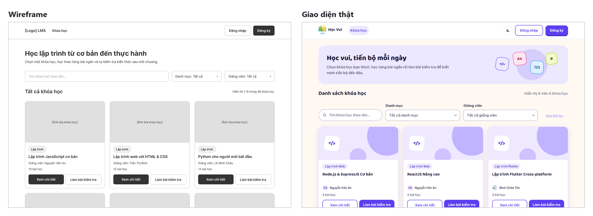
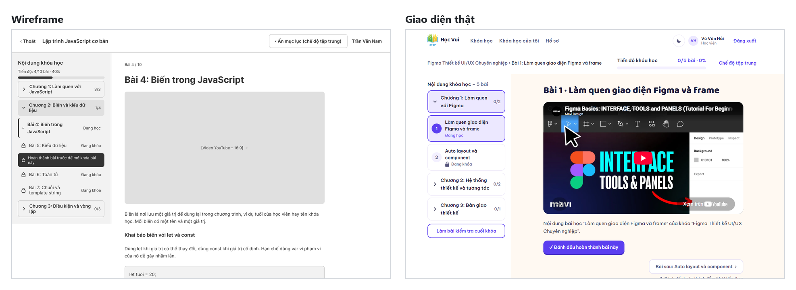
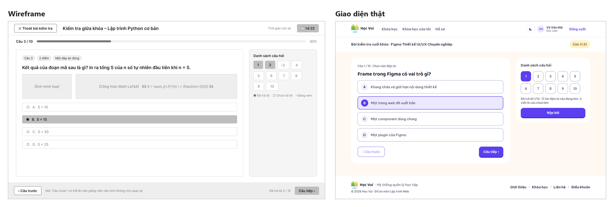
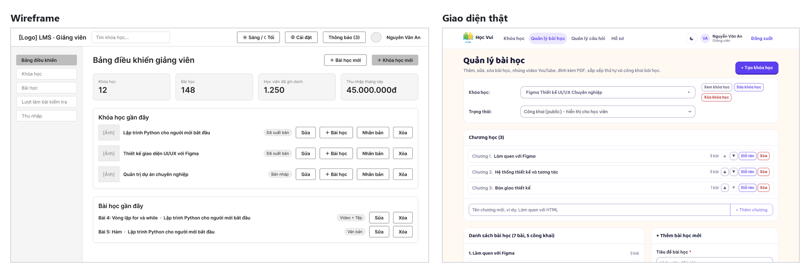
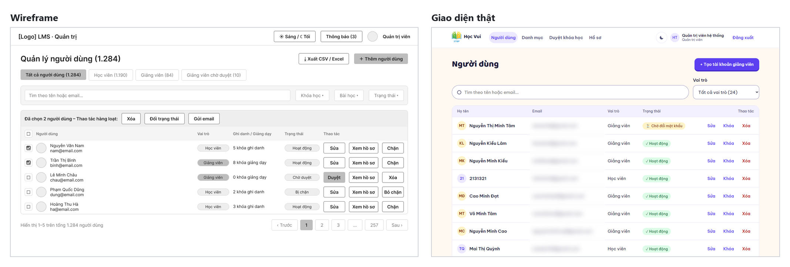
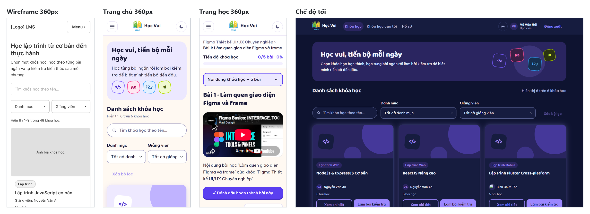

## 5.4. Thiết kế giao diện (wireframe → giao diện thật)

### 5.4.1. Quy trình thiết kế
Giao diện được làm qua ba bước, mỗi bước có sản phẩm lưu lại trong kho mã:

1. **Wireframe (Figma, đen trắng):** phác bố cục, luồng thao tác và các trạng thái của từng màn hình (rỗng, lỗi, đang tải, không có quyền) trên hai khổ: máy tính 1366 px và điện thoại 360 px. Ảnh xuất lưu ở `docs/wireframes/`; tên tệp theo mã màn hình, ví dụ `01 – Danh sách khóa học.png` và `M01 – … (di động).png`.
2. **Mockup (Figma, có màu):** áp dụng hệ thống thiết kế "Học Vui" lên wireframe. Hệ thống gồm biến màu sáng/tối, kiểu chữ, nút, thẻ khóa học, huy hiệu trạng thái. Mockup là bản đối chiếu khi lập trình.
3. **Giao diện thật (React 19 + React-Bootstrap):** dựng lại mockup bằng các thành phần dùng chung trong `frontend/src/components/` và biến CSS `--ht-*` trong `frontend/src/styles/theme.css`. Dữ liệu được lấy từ REST API thật của backend.

Ở mỗi bước, nhóm rà lại theo các yêu cầu chức năng (HT-01 … HT-15). Chức năng nào wireframe có mà đặc tả không yêu cầu thì lược bỏ khi lên giao diện thật, ví dụ xuất CSV, thu nhập giảng viên, nhân bản khóa học. Việc này giữ giao diện khớp với phạm vi đề tài.

### 5.4.2. Hệ thống thiết kế "Học Vui"
| Thành phần | Quy ước | Mục đích |
| :--- | :--- | :--- |
| **Màu chủ đạo** | Tím `#5B3FF0` (nút chính, liên kết, mục đang chọn); nền trang kem `#FFF9F2`, nền khối trắng; chữ chính `#1B1A3A`. | Phong cách học tập vui, năng động nhưng vùng đọc vẫn sáng, dịu. |
| **Màu theo danh mục** | Mỗi danh mục một bộ màu (`.ht-cat--*`): Lập trình tím, Thiết kế hồng, Ngoại ngữ xanh ngọc, Kinh doanh cam, Dữ liệu xanh dương, Marketing vàng chanh. | Nhận diện nhanh khóa học trên thẻ, chip danh mục và ảnh bìa. |
| **Kiểu chữ** | Tiêu đề: *Baloo 2* (tròn, đậm); nội dung: *Be Vietnam Pro*, cỡ 16–18 px, giãn dòng 1,6–1,75. Cả hai phông hỗ trợ đầy đủ dấu tiếng Việt. | Dễ đọc bài học dài, tiêu đề có cá tính. |
| **Thành phần** | Nút `.ht-btn` (chính / phụ / chữ), thẻ bo góc lớn, huy hiệu trạng thái có biểu tượng, hộp thoại xác nhận, thông báo (toast). | Thống nhất giữa 3 vai trò, giảm mã CSS lặp. |
| **Chế độ sáng / tối** | Nút mặt trăng / mặt trời trên thanh điều hướng; lưu lựa chọn trong `localStorage` (`ht-theme`) và đặt `data-theme="dark"` trên thẻ `<html>`. Chế độ tối dùng nền xanh đen `#0E1330` với màu neon, không dùng đen tuyền. | Học buổi tối đỡ mỏi mắt; toàn bộ màu đổi qua biến CSS, không viết lại từng trang. |

### 5.4.3. Giao diện theo vai trò
**Học viên và khách vãng lai.** Trang chủ (HT-01) giữ bố cục wireframe: ô tìm kiếm, lọc theo danh mục và giảng viên, lưới thẻ khóa học, mỗi thẻ có hai nút *Xem chi tiết* và *Làm bài kiểm tra*. Bản thật thêm khối chào mừng và ảnh bìa theo màu danh mục (Hình 5.4.1).

Trang học (HT-05) có ba phần:
- Mục lục chia theo chương ở bên trái, mỗi trang mục lục 8 bài, tên bài tối đa 2 dòng.
- Video, văn bản hoặc PDF ở giữa.
- Thanh tiến độ và *Chế độ tập trung* ở trên cùng.

Bài chưa mở được đánh dấu bằng biểu tượng ổ khóa và chữ "Đang khóa". Cách hiển thị này thể hiện quy tắc học tuần tự HT-NFR2 (Hình 5.4.2).

Trang làm bài kiểm tra (HT-06) hiển thị từng câu một. Bảng *Danh sách câu hỏi* bên phải cho biết câu nào đã trả lời. Đồng hồ đếm ngược đổi màu khi sắp hết giờ, và trước khi nộp có hộp thoại xác nhận nhắc số câu còn bỏ trống (Hình 5.4.3).

**Giảng viên.** Wireframe ban đầu là một "bảng điều khiển" nhiều số liệu. Khi lên giao diện thật, nhóm tập trung vào nghiệp vụ chính là quản lý khóa học → chương → bài học trên cùng một trang. Trang này cho phép:
- chọn khóa học và trạng thái công khai/nháp;
- đổi tên, sắp xếp, xóa chương;
- thêm bài học (video YouTube, PDF tối đa 5 MB) ở cột bên phải.

Thao tác xóa luôn có màu đỏ và hộp thoại xác nhận (Hình 5.4.4).

**Quản trị viên.** Trang *Người dùng* (HT-14) có tìm kiếm theo tên/email, lọc vai trò kèm số lượng, phân trang ở máy chủ và nút *Tạo tài khoản giảng viên*. Trạng thái tài khoản dùng huy hiệu có biểu tượng và chữ: "✓ Hoạt động", "⏳ Chờ đổi mật khẩu", "◌ Đã khóa". Wireframe có thao tác hàng loạt và duyệt giảng viên, nhưng đặc tả không yêu cầu nên được lược bỏ (Hình 5.4.5). Trang *Danh mục* và *Duyệt khóa học* (HT-15) dùng cùng bố cục bảng và hộp thoại.

### 5.4.4. Responsive và khả năng truy cập
- **Responsive:** kiểm tra ở 1366 px và 360 px.
  - Trên điện thoại, thanh điều hướng thu vào nút menu.
  - Mục lục trang học chuyển thành khối gập *Nội dung khóa học*.
  - Bảng quản trị chuyển thành dạng thẻ: mỗi hàng là một thẻ, không cuộn ngang.
  - Các nút trên thẻ khóa học giãn bằng nhau ở mọi độ rộng (Hình 5.4.6).
- **Tương phản:** chữ trên nền màu đạt chuẩn WCAG AA, áp dụng cho cả hai chế độ sáng/tối.
- **Không dùng màu làm tín hiệu duy nhất:** đúng/sai, trạng thái bài học và trạng thái tài khoản luôn có thêm biểu tượng và chữ (✓, ✗, ổ khóa, "Đang học").
- **Bàn phím và trình đọc màn hình:**
  - Nút chỉ có biểu tượng đều có `aria-label`.
  - Hộp thoại giữ tiêu điểm bên trong và đóng được bằng phím Esc.
  - Ô nhập liệu đều có nhãn `<label>`, báo lỗi ngay dưới ô.

### 5.4.5. Hình minh họa
Mỗi hình đặt wireframe (bên trái) cạnh giao diện thật (bên phải). Ảnh giao diện thật được chụp từ ứng dụng chạy với backend và cơ sở dữ liệu mẫu của nhóm. Riêng cột email ở Hình 5.4.5 được làm mờ.

*Hình 5.4.1. Trang chủ – danh sách khóa học (HT-01): wireframe và giao diện thật.*

*Hình 5.4.2. Trang học bài (HT-05): mục lục theo chương, bài khóa có biểu tượng ổ khóa, thanh tiến độ.*

*Hình 5.4.3. Trang làm bài kiểm tra (HT-06): từng câu một, danh sách câu hỏi và đồng hồ đếm ngược.*

*Hình 5.4.4. Giảng viên – quản lý khóa học, chương và bài học.*

*Hình 5.4.5. Quản trị viên – quản lý người dùng (HT-14); trạng thái có biểu tượng và chữ, không chỉ dựa vào màu.*

*Hình 5.4.6. Wireframe điện thoại, trang chủ và trang học ở 360 px, trang chủ ở chế độ tối.*
